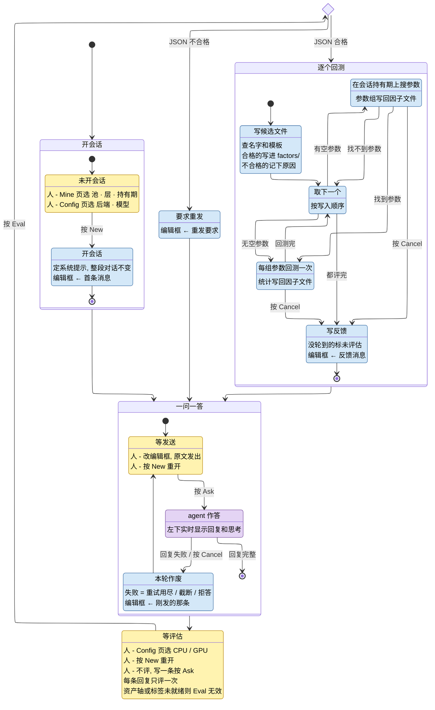

# Agent 挖因子

人在 GUI 的 Agent → Mine 页操作. 系统 (本程序) 与 agent (大模型) 一问一答: 系统把可用的特征和算子告诉 agent, agent 每次交一批因子模板, 系统逐个回测, 把成绩发回给它, 它据此改进再交.

## 名词

| 名词       | 含义                                                                                                                  |
| ---------- | --------------------------------------------------------------------------------------------------------------------- |
| 池         | 股票池: `all` (全市场) 或某个子池                                                                                     |
| 层         | 因子在哪个频率上算: `min` / `5min` / `15min` / `30min` / `60min` / `day`                                              |
| 持有期     | 因子预测多远的收益: `30m` / `60m` / `close` / `T+1O` / `T+1C` (该层能用的才列出)                                      |
| 模板       | 因子表达式, 窗长等参数可以不写数字 (裸写 `d` / `k`), 交给 Search 定值. 例: `CsRank(TsMeanRoll(TsLog(bar.5m.amt), d))` |
| 候选       | agent 交的一个因子: 英文名 + 中文名 + 模板 + 一句话假设                                                               |
| 批         | agent 一次回复里的全部候选 (每次 8 个)                                                                                |
| Search     | 给模板里没写数字的参数找最好的取值; 可能一组都找不到 (= 无显著), 也可能找到几组                                       |
| Run        | 对一组定好值的参数做全区间分层回测, 出 score / 多空收益 / rIC / 单调性等统计                                          |
| 会话       | 按 New 开始的一段连续对话. 池 / 层 / 持有期 / 后端 / 模型在会话内不变                                                 |
| 会话目录   | `output/agent/<池>/<层>/<持有期>/`: `factors/` 放候选因子文件 (历次会话累积), `chat/<时间>/` 放这段对话发收的每条消息 |
| 编辑框     | Mine 页左上: 下一条要发给 agent 的消息. 系统自动填好, 人可以改                                                        |
| 结果表     | Mine 页右侧: 会话目录里全部候选及其回测统计, 按 score 降序                                                            |
| 正式因子库 | `output/factors/<池>/<层>/`: Factors 页用的因子. 只有人在结果表按 Adopt 才往里加 (有参数组的行, 任何时候都能按)       |

## 状态图

- 颜色 = 这一步谁在干活: 黄 = 等人, 紫 = agent, 蓝 = 系统; 菱形 = 系统判断
- 箭头: `按 X` = 人的操作, 其余 = 条件 (成对出现)
- 状态: `人 -` = 人在这里能做的, `编辑框 ←` = 系统往编辑框填什么, 其余 = 这一步做什么

## 系统发给 agent 的消息

四种消息的模板都在 `config/agent/prompt/` 下, Config 页可直接改.

| 消息     | 内容                                                                                                                                                  |
| -------- | ----------------------------------------------------------------------------------------------------------------------------------------------------- |
| 系统提示 | 池 / 层 / 持有期; 表达式写法; 回测口径; 研究要求; 回复格式; 该层能用的全部特征; 全部算子; 正式因子库里已有因子在该持有期的成绩. 中途 Adopt 不会更新它 |
| 首条     | 会话目录里以前试过的候选 (历次会话累积, 让 agent 别重复) + "交第一批"                                                                                 |
| 反馈     | 本批每个候选的结局 (下表) + "判断哪些假设成立, 交下一批"                                                                                              |
| 重发要求 | 哪里不合格式 + "按格式重发"                                                                                                                           |

agent 每次只回一个 JSON: `{"factors": [{"name": 英文名, "name_cn": 中文名, "expr": 模板, "note": 一句话假设}, ...]}`, 每批 8 个.

候选的结局 (反馈消息逐个写, 结果表 "结局" 列同样显示):

| 结局     | 含义                                                                        |
| -------- | --------------------------------------------------------------------------- |
| 未落文件 | 名字或模板不合法, 或与已有的重名; 原因原样告诉 agent, 改正后可以重交        |
| BROKEN   | 文件写成了, 但回测时算不出来                                                |
| 无显著   | Search 找不到显著的参数                                                     |
| 有参数组 | 每组参数给 score / 每期多空收益 / rIC 及其 IR 和 t 值 / 单调性 / 池内有效率 |
| 未评估   | 按 Cancel 时还没轮到                                                        |

## 自动

在等发送或等评估时填轮数 N 按 Auto: 黄色步骤不再等人, 系统自动按 Ask / Eval, 一直循环. 每发一条消息算一轮 (重发要求也算).

以下任一情况发生就停在等发送或等评估, 回到手动:

- 人按 Pause: 当前这步做完再停
- 人按 Cancel: 立即停
- N 轮用完
- 回复失败
- 连续 2 次回复不合格式
- 资产轴没扫描或标签没算
- 连续 3 轮整批候选都没找到参数
