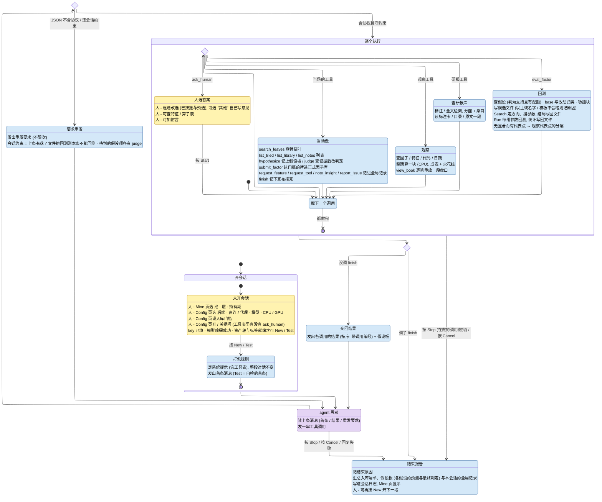

# Agent 挖因子

人在 GUI 的 Agent → Mine 页操作. 系统 (本程序) 把项目规则与一张工具表打包发给 agent (大模型); 此后 agent 每条回复发一串工具调用, 系统按序执行, 下条消息按序交回结果. 工具分几类: 看数据 (特征长什么样 / 分层 / 交割单 / 一端的常客 / 个股一天或多日), 查研报库 (从全库版图逐层收窄到研报 / 研报里的因子, 读标注卡与原文), 回测候选, 列已试候选与正式库, 提交入库, 提交与查阅全局记录 (特征申请 / 工具申请 / 发现 / 建议与 bug), 问人 (Config 页允许时, 整段会话一次), 宣布挖完. agent 像研究员一样先看后改: 从观察里找具体现象, 把它写成机制假设与可证伪的预测记上假设板, 用观察检验后判定, 只在判为支持的假设上设计针对它的改动 (变体), 回测后先诊断再判定, 做到改不动时把最好的版本提交入库并宣布挖完. 一段会话只做一个因子, 好坏先看分层清晰 (mono), 再看多空收益: 分层做不出来 (mono 不到 Search 门槛) 的因子没有分析价值, 先想尽办法把分层做出来; 过入库门槛的版本优先, 都过门槛时 mono 不明显下降 (≤ 0.01) 而每期毛多空更大 (超出噪声) 者更好; rIC 只作入库底线, 不管风格与相关性. 途中 agent 提的特征 / 工具申请、发现与问题记成全局记录, 跨会话累积: 人在 "候选" 页看, 后续会话的 agent 也查得到.

## 名词

| 名词       | 含义                                                                                                                                                                                                                                                                                                                                                         |
| ---------- | ------------------------------------------------------------------------------------------------------------------------------------------------------------------------------------------------------------------------------------------------------------------------------------------------------------------------------------------------------------ |
| 池         | 股票池: `all` (全市场) 或某个子池                                                                                                                                                                                                                                                                                                                            |
| 层         | 因子在哪个频率上算: `min` / `5min` / `15min` / `30min` / `60min` / `day`                                                                                                                                                                                                                                                                                     |
| 持有期     | 因子预测多远的收益: `30m` / `60m` / `close` / `T+1O` / `T+1C` (该层能用的才列出)                                                                                                                                                                                                                                                                             |
| 模板       | 因子表达式, 窗长等参数可以不写数字 (裸写 `d` / `k`), 交给 Search 定值. 例: `CsRank(TsMeanRoll(TsLog(bar.5m.amt), d))`                                                                                                                                                                                                                                        |
| 具体式     | 不含裸参数的表达式; 观察工具只接具体式                                                                                                                                                                                                                                                                                                                       |
| 工具       | agent 能调的一项能力: 名 + 参数表 (类型 / 缺省 / 取值范围) + 做什么 + 返回什么; 全部列在系统提示的 "工具" 节                                                                                                                                                                                                                                                 |
| 调用       | `{"tool": 工具名, "args": {...}}`; 一条回复 1..12 个, 系统按序执行; 每个调用的结果至多 6000 字                                                                                                                                                                                                                                                               |
| 候选       | agent 用 eval_factor 交的一个因子变体: 英文名 + 中文名 + 模板 + 所挂的假设 + base (相对哪个已试候选) + 改动 (想修哪个现象、改了哪一处) + 预期 (一个方向) + 功能块; 系统把后几项拼成 note 落进候选文件                                                                                                                                                        |
| 假设板     | 一段会话里 agent 提的机制假设 (hypothesize: 谁在做什么 / 为什么预示收益 / expect 预期在哪个观察里看到什么 / refute 看到什么算落空), 编号 H1, H2 …; 判定 (judge) = 待检验 / 支持 / 落空 / 不清, 证据写调用编号. 判为支持的才能挂变体, 每个至多 3 个 (其中旋钮类至多 1 个); 变体回测过即待判, 下一条回复须判它. 每条结果消息附整张板                           |
| 调用编号   | `R<轮>#<序>`: 第几轮回复里的第几个调用 (从 1 起), 结果标题里给出; judge 的证据引用它                                                                                                                                                                                                                                                                         |
| 改动归类   | 系统逐节点比对候选与 base 的模板, 差异处归一类: 只改参数 / 改了多处 / 同式 (退回), 换平滑 / 换压缩 / 换口径 (旋钮类: base 未达入库门槛则退回), 换原料 / 加变换 / 去变换 / 加项 / 条件化 / 减项 / 改结构; 同算子而一边整个是另一边的一元 (`TsAdd(a, b)` → `TsAdd(TsAdd(a, b), c)`) 算一处; base 空 (新起) 也与全部已试候选比, 只差参数或一处旋钮的按它当 base |
| 功能块     | 模板里的一段子式 + 一句 ≤ 30 字 (不计空格标点) 的短句说它衡量什么; 须覆盖根的输入与每个多元算子的每个非叶元, 至多 9 块 (= 算子数上限 − 1, 装得下最大的式子); 漏了时列出全部要说明的子式并标有 / 缺                                                                                                                                                           |
| 同组叶     | 列名按 `_` 切词后只差计量 (额 amt / 量 vol / 笔 n / all) 或阈值 / 窗口 (带数字的词) 的叶; 系统提示的特征表与 search_leaves 都把一组合成一行 (列写成花括号式), search_leaves 列出一组即整组记为已查; 两叶互换归 "换口径"                                                                                                                                      |
| Search     | 定方向并给模板里没写数字的参数找最好的取值 (没有空参数的只评本身); 只认 mono 过门槛的, 目标 = 多空 × rIC × mono²; 可能一组都找不到 (= 无显著), 也可能找到几组                                                                                                                                                                                                |
| 评估期     | 统计所在的交易日段 (所用特征库落盘日的交集); 只有与作用域此刻评估期相同的统计才给 agent 看, 不同窗口的数不可比                                                                                                                                                                                                                                               |
| Run        | 对一组定好值的参数做全区间分层回测, 出 score / 多空收益 / rIC / 单调性等统计                                                                                                                                                                                                                                                                                 |
| 观察       | 在评估期上整期算一次因子 / 特征 (CPU, 不写文件), 汇总成表与火花线交给 agent; 与分层回测同一份分组与持仓判据                                                                                                                                                                                                                                                  |
| 入库门槛   | Config 页设的统计下限 (mono / rIC 均值; 多空不设门槛); agent 提交的候选至少有一组参数全部达到才入库                                                                                                                                                                                                                                                          |
| 会话       | 按 New 开始的一段连续对话. 池 / 层 / 持有期 / 后端 / 模型 / 入库门槛 / 可否提问在会话内不变                                                                                                                                                                                                                                                                  |
| 自检会话   | 按 Test 开始的会话: 系统提示同 New, 首条换成 test 模板, 让 agent 把每个工具调一遍 (含故意写错的参数), 问题记 report_issue, 末了总评; 候选 / 日志 / 全局记录进 `output/agent/global/test/`, 提交只查门槛不拷进正式库                                                                                                                                          |
| 选项记忆   | Mine 页作用域与 Config 页全部选项改了即存 `config/agent/ui.json` (本机, 不进仓库), 下次启动沿用; 失效的项回落默认                                                                                                                                                                                                                                            |
| 会话目录   | `output/agent/<池>/<层>/<持有期>/`: `factors/` 放候选因子文件 (历次会话累积), `chat/<时间>/` 放会话日志                                                                                                                                                                                                                                                      |
| 会话日志   | 这段对话发收的每条消息 + 带毫秒时间的交互流水 `events.jsonl` (每一步一行) + 结束报告                                                                                                                                                                                                                                                                         |
| 全局目录   | `output/agent/global/`: 不随作用域、不与会话目录混放的东西 —— 全局记录 (一类一个文件)、工具样本 `tools/`、自检会话 `test/` (其下 `<池>/<层>/<持有期>/{factors,chat}` 与自检的全局记录)                                                                                                                                                                       |
| 全局记录   | agent 用 request_feature / request_tool / note_insight / report_issue 提交的特征申请 (F) / 工具申请 (T) / 发现 (I) / 建议与 bug (R): `global/<类>.jsonl` 一条一行 (编号 + 时间 + 作用域 + 出处 + 附议哪条 + 字段); 跨会话、跨作用域累积, agent 经 list_notes 查, 同类已有的用 ref 附议                                                                       |
| 工具样本   | `output/agent/global/tools/<工具名>.md`: 每个工具最近一次交给 agent 的结果 (调用 + 出处 + 截断后的原文), 跨会话互相覆盖; 开会话时删掉工具表里已没有的工具的文件                                                                                                                                                                                              |
| 提问面板   | ask_human 调用在过程页展开: 问题逐题列出选项, 推荐项标出并预选, 每题末项 "其他" 可自己写意见; 底下一个附言框                                                                                                                                                                                                                                                 |
| 参考表     | Mine 页 "特征" / "算子" / "工具" 页: agent 能用的全部特征 (系统提示里按族列族卡 + 叶名与中文名 (同组叶合一行), 公式与说明 agent 经 search_leaves 查; 过滤也匹配族)、算子表与工具表 (执行方 / 参数 / 说明 / 返回, 同系统提示的工具节; 可过滤), 人读题、看模板用; 特征与算子随作用域, 不必开会话                                                               |
| 结果表     | Mine 页 "候选" 页: 子页 "因子" = 会话目录里全部候选及其回测统计, 按 score 降序, 入库的标出, 随作用域; 其余子页 = 各类全局记录, 新到旧 (编号 / 时间 / 作用域 / 附议 / 标题与字段), 只读; 都不必开会话                                                                                                                                                         |
| 正式因子库 | `output/factors/<池>/<层>/`: Factors 页用的因子                                                                                                                                                                                                                                                                                                              |

## 状态图

- 颜色 = 这一步谁在干活: 黄 = 等人, 紫 = agent, 蓝 = 系统; 菱形 = 系统判断
- 箭头: `按 X` = 人的操作, 其余 = 条件 (成对出现)
- 状态: `人 -` = 人在这里能做的, `发出` = 系统发给 agent 的消息, 其余 = 这一步做什么



- 按 Stop: 选答案时立即结束; agent 思考中 → 收到回复后结束 (不执行其中的调用); 执行中 → 在做的调用做完后结束 (不再交回结果)
- 按 Cancel: 立即结束, 在跑的回复 / 回测 / 观察作废
- 网络抖动一直重试 (每 30 秒一次, 不限次数), 不算失败; 按 Cancel / 退出程序随即收手
- 回复失败: 请求发出后断网 (Cursor 建 agent / 续对话的 POST 不重发) / 接口报错 (如模型在出口地区不可用) / 代理拒绝 / 回复被截断 / 平台拒答; 原因进结束报告

## 系统发给 agent 的消息

模板都在 `config/agent/prompt/` 下, Config 页可直接改.

| 消息     | 内容                                                                                                                                                                                                                                                                                                                                                                                                                                                                                                                                                                                                                                                                                                                                                                                                                                                                                                                                                                                                                                                                                                                                                                                                                                                                                                                                                                                                                            |
| -------- | ------------------------------------------------------------------------------------------------------------------------------------------------------------------------------------------------------------------------------------------------------------------------------------------------------------------------------------------------------------------------------------------------------------------------------------------------------------------------------------------------------------------------------------------------------------------------------------------------------------------------------------------------------------------------------------------------------------------------------------------------------------------------------------------------------------------------------------------------------------------------------------------------------------------------------------------------------------------------------------------------------------------------------------------------------------------------------------------------------------------------------------------------------------------------------------------------------------------------------------------------------------------------------------------------------------------------------------------------------------------------------------------------------------------------------- |
| 系统提示 | 角色 (微观结构; 先分层 / 再多空 / 不管的; 先看再想机制再改); 作用域 (池 / 层 / 持有期 / 评估期); 行与时刻 (每行何时算因子、何时开 / 清仓, 15min 例 + 本层的竞价段行数与行末时刻; 参数按行、粗层叶的可见时点); 表达式 (语法 + 参数 / 叶 / 根 / 类型 / 规模); 评估口径 (系统已定: 开仓 / 分组 / 多空 / 收益 / 特殊情况 / 方向; Search: 门槛 / 目标 / 显著 / 终选; 结果怎么读: 有权重、无显著 (三类代表点 → 差在哪 → 下一步的表)、参数曲面); 判优 (噪声内算持平、达标、何为更好的表、接续); 研究循环 (看 → 假设 → 检验 → 判定 → 变体 → 诊断 → 再判定的表: 每步做什么 / 工具 / 系统约束; 假设五栏、判定五问、诊断、落空、换向、连续 3 批无进展收手); 观察 (想知道什么 → 用哪个观察工具的表; 起步、只改聚合现象、个股只看机制不设门控、盘口叶有缺失日); 改动 (改一处、有依据、先分层、门槛前不拧压缩 / 平滑 / 同族口径、根只排序、截面时序同等、新子式先看、功能块); 叶与研报 (先族卡、eval_factor 只收查过的叶组、分清主动侧与挂单侧; 研报何时查 / 怎么查 / 借机制不借数字); 全局记录 (情形 → 工具的表, 先查同类再附议); 回复协议 (限额 / 整条退回 / 单个失败 / 结果 / 截断 / 历史折叠 / 打包省轮次); 工具表; 该层能用的全部特征 (按特征族分节: 族卡 (`config/agent/families.md`, 族 = 定义它的节点文件: 记的是谁的什么行为 / 维度结构 / 机制 / 坑; 用到的族缺卡即 assert) + 族内按 档.层 分组的 列名 + 中文名 + 落盘变换标记, 如 [对数]: 落盘值不是原量, 算子里没有逆变换; 同组叶合一行: 花括号式 + 个数 + 首个的中文名); 全部算子 |
| 首条     | 现状: 已试候选与正式库 (同评估期) 的个数 + 全局记录各类条数 (发现另给本作用域的), 各配查看的工具 + 起步: 怎么定因子 (可提问时: 可先看几眼再一次问完; 否则自定因子与方向), 首条回复一次发齐 前人 / 研报 / 原料 / 起点 四样观察, 之后 hypothesize → 观察检验 → judge 为支持才回测                                                                                                                                                                                                                                                                                                                                                                                                                                                                                                                                                                                                                                                                                                                                                                                                                                                                                                                                                                                                                                                                                                                                                 |
| 自检     | 自检会话的首条 (代替首条): 每个工具至少调一次、各取值都覆盖、每类数据参数故意写错一两个、交模板前先查过它的叶并另交一个用没查过的叶的看退回、假设板提两条: 一条观察后判支持, 并试 judge 的退回 (编号不存在 / 在提出之前 / 支持却无观察 / 再判无新证据), 另一条判落空; eval_factor 都挂支持的那条: 交正式库里有权重的模板 (没有则取已试候选里有参数组的, 也没有就再自写一个并在总评注明) + 一个自写 + 一个不合法, 另交一个挂落空假设的看退回, 拿有权重的喂观察与提交、无显著的喂观察看代表点; 回测后下一条故意再回测且不判看整条退回; 以刚评的为 base 试只改数字 / 改两处 / 换平滑 / 功能块漏块的退回; 全局记录四个工具各提一条并试附议与错的 ref; 对照说明查结果, 问题即记 report_issue, 末了总评再 finish                                                                                                                                                                                                                                                                                                                                                                                                                                                                                                                                                                                                                                                                                                                      |
| 结果     | 上条回复每个调用一节 (标题 = 调用编号 + 调用本身, 长参数只写开头, 没做成的标出) + 假设板 (每个假设的判定 / 变体与旋钮类用量 / 提出与最近判定处 + 待判的) + 下一步 (挖掘: 判 / 因 / 料 / 记 四问 —— 各假设的 expect / refute 谁被支持谁落空、错在哪一环、有没有更直接捕捉这一现象的特征、哪条认识值得 note_insight; 上条有落了文件的回测时 "本条只诊断" (判支持的观察排在 judge 前), 否则 "本条可回测" (只挂判为支持的假设, 按判优比较); 自检: "接着调没调过的, 全调过后总评再 finish"). 智谱后端本地留历史: 未折叠的消息攒到 6 条, 就把最近 3 条之前的结果消息成批换成折叠版 (观察与查询只留标题, 回测只留一行结局, 提交 / 问答 / 假设与判定 / 没做成的原因原样; 成批换让多数轮的历史前缀不变, 远端缓存接得上); Cursor 后端历史在远端, 不折叠                                                                                                                                                                                                                                                                                                                                                                                                                                                                                                                                                                                                                                                                                   |
| 重发要求 | 哪里不合协议或违了哪条会话约束 + "整串重发"                                                                                                                                                                                                                                                                                                                                                                                                                                                                                                                                                                                                                                                                                                                                                                                                                                                                                                                                                                                                                                                                                                                                                                                                                                                                                                                                                                                     |

## agent 的回复

每次只回一个 JSON:

```json
{"calls": [{"tool": "view_layers", "args": {"factor": "VolSkewTail", "cond": "lob.1m.spread_l1"}},
           {"tool": "judge", "args": {"hyp": "H2", "verdict": "supported", "evidence": ["R7#2", "R8#1"], "result": "...", "why": "...", "insight": "...", "better_feature": "...", "next": "..."}},
           {"tool": "eval_factor", "args": {"name": "VolSkewTail_noLim", "name_cn": "量偏尾去涨停", "expr": "...", "hyp": "H2", "base": "VolSkewTail", "change": "...", "expect": "...",
                                            "parts": [{"expr": "...", "means": "..."}]}}]}
```

- 1..12 个调用; eval_factor 至多 3 个; finish 只能在最后; ask_human 只在允许提问且还没问过时可用, 一条回复至多一个
- 会话约束: 上一条执行了的回复有落了文件的 eval_factor, 这一条就不能有; 假设板上待判的假设, 这一条须各有一个 judge; 违了整条退回重发 (原因写违的哪条)
- eval_factor 的 parts 1..9 块, 每块须是 {expr, means} 且 means 1..30 字 (不计空格标点), judge 的 evidence 1..6 个, 不合同属参数不合
- 参数不合工具表 (未知工具 / 未知参数 / 缺必填 / 类型 / 范围 / 可选值) 或同一 JSON 对象里键重复 → 整条退回重发, 原因带字段路径与实收数 (调用数 / 第几个 eval_factor / 该工具的参数); 依赖数据或会话状态的 (因子 / 特征 / 代码 / 日期 / 假设 / base / 证据编号) 不成只在该调用的结果里写原因, 其余照做 (exprs 里某式不成同理: 只在该式那里写原因, 其余式照算); 表达式解析不成的原因带出错处前后的片段 (‸ 指位)

工具 (工具表在 `cpp/src/agent/Tools.cpp`, 系统提示的 "工具" 节由它生成):

| 工具            | 执行 | 做什么                                                                                                                                                                                                                                                                                                                                                                                                                                                                                                                                         |
| --------------- | ---- | ---------------------------------------------------------------------------------------------------------------------------------------------------------------------------------------------------------------------------------------------------------------------------------------------------------------------------------------------------------------------------------------------------------------------------------------------------------------------------------------------------------------------------------------------- |
| view_feature    | 观察 | 1..4 个特征式: 池内分布 / 日内轮廓 / 方差来自资产间 · 日间 · 日内 / 同资产自相关 / 与收益的截面 rIC (分时段); 多个时附两两截面相关                                                                                                                                                                                                                                                                                                                                                                                                             |
| view_layers     | 观察 | 因子的 20 组分层: 每组每期超额 / mono / 多空 / rIC / 每组真持有只数 (各组差不出一成时只给范围); 可按日内时段或按月切开 (全期部分照给); cond = 条件特征式: 每行按它把池子截面三等分, 段内重新分 20 组 (标签口径近似), 低 / 中 / 高与全体各一行, 附条件与因子的相关、条件自身 rIC; 尾部表: 做多端 G20 与最低组 G1 组内各截最极端 50% / 20% / 5% (各沿自己的交接链持仓, 与 Inspect 同一份), 给两端每期超额 / 行均只数 / 多空                                                                                                                      |
| view_trades     | 观察 | 交割单: 因子一端真持有过的格, 按 none / run / day 合并成段; 段收益分布与集中度、开仓时段表、盘面标签 (涨跌停附近 / 大涨大跌 / 日内高低位 / 放量 / 竞价段 / 尾盘) 的格占比提升 (本端格对池内格) 与开仓带标签的段收益、随机 (默认) / 最差 / 最好明细 (两端标为尾部个例); from / to 只看该日段, tod = HH:MM-HH:MM 只看行末时刻在其中的行 (持仓格与对照的池内格同窗, 跨窗的段被截断)                                                                                                                                                               |
| view_holders    | 观察 | 一端的常客: 每只本端行数 / 占其在池 / 天数 / 平均连续行数 / 持仓格均超额, 附集中度                                                                                                                                                                                                                                                                                                                                                                                                                                                             |
| view_response   | 观察 | 响应曲线 (事件研究): 以真持有段的开仓行为零点, 开仓前各时点到开仓 / 开仓到之后各时点的全池平均累计超额 (对数, 减同行在池均值, 跨日按昨收接) ± 按开仓日聚类的标准误、为正占比、各时点因子分位; 开仓行因子分位与此前收益的截面 rank 相关; split=tod 按开仓时段各一行                                                                                                                                                                                                                                                                             |
| view_explain    | 观察 | 成分剥离: 内置基准 (日内层: 近 5 / 30 行、当日至今、前 1 / 5 日收益, 当日至今成交额 / 振幅, 日内位置, 价格; 日层: 当日 / 近 5 / 20 日收益, 成交额, 振幅, 价格) + 至多 4 个特征式, 各给与因子的截面秩相关 / 自身 rIC / 只剥它后的因子 rIC; 全部一起剥 (逐行截面回归取残差) 给平均 R², 原因子与剩余部分的 rIC / mono / 多空 / 20 组 (标签口径近似); 抽至多 3000 行                                                                                                                                                                               |
| view_snapshot   | 观察 | 某日某一行的截面: 因子分位最高 / 最低各 n 只 (分位 / 组 / 是否真持有 / 当日与本行涨跌 / 日内位置 / 当日至此成交额 / 后续超额 / 盘面标签 / 至多 3 个特征值), 中夹池中位一行; 附各列与因子分位的截面秩相关                                                                                                                                                                                                                                                                                                                                       |
| view_stock_day  | 观察 | 一只票一天: 当日概况 + 价 / 量 / 因子分位 / 特征的火花线 + 分段表 (竞价段 + 约 30 分钟一段); rows = HH:MM-HH:MM 时另附逐行表 (至多 40 行: 收 / 涨跌 / 当日 / 量 / 额 / 因子分位与组 / 后续超额 / 特征值)                                                                                                                                                                                                                                                                                                                                       |
| view_stock_days | 观察 | 一只票连续至多 60 日: 逐日涨跌 / 振幅 / 成交额 / 在池 / 因子分位 / 两端行数 / 收盘开仓超额 / 特征收盘值                                                                                                                                                                                                                                                                                                                                                                                                                                        |
| view_book       | 重放 | 逐笔重放一只票一天里的一段 (至多 30 分钟交易时间, 可跨午休 / 含竞价; 不经特征库, 不限评估期; 当日无逐笔帧即说明原因): 当日概况 + 窗口汇总与逐秒火花线 + 逐时表 (每行 step 秒, 至多 30 行: 末价 / 买一卖一 / 价差 / 主动买卖额 / 新挂与撤单额分侧 / 前五档挂单额; 竞价段另有预撮合参考价 / 匹配额 / 未匹配额) + 大单事件 (委托额 ≥ 门槛 (缺省当日新挂单额 99 分位) 的新挂 / 撤单 / 被吃完, 连续竞价里一个主动单连吃 ≥ 2 价位或成交额 ≥ 门槛的扫单; 分侧计数 + 额最大的 n 起按时序, 带距盘口几跳与寿命) + 某一秒末的全簿剖面 (盘口两侧各 8 价位) |
| search_leaves   | 当场 | 按关键词查特征叶 (叶名 / 中文名 / 公式 / 说明): 命中的叶数与组数 + 命中的叶所在的同组各一行 (整组写成花括号式, 公式 / 说明 / 落盘值按组内首个命中的); n 数组; 零命中给各词单独的命中数; 系统提示的特征表只列族卡与叶名中文名, 定义从这里查; 列出的组整组记入本会话已查集合 (eval_factor 只收它们)                                                                                                                                                                                                                                              |
| search_docs     | 研报 | 按阶段 / 流派 / 资产 / 数据频率 / 体裁 / 关键词 (标注或全文) 查研报: 命中集合的分面 (阶段 → 流派树 / 机构 / 年份 / 价值) + 研报行; 全文检索另给命中处的小节与片段                                                                                                                                                                                                                                                                                                                                                                              |
| search_factors  | 研报 | 按类别 / 数据周期 / 预测期 / 出处流派 / 资产 / 关键词查研报里的因子: 分面 (类别 / 流派 / 数据周期 × 预测期) + 因子行 (方向 / 原文统计 / 公式 / 出处)                                                                                                                                                                                                                                                                                                                                                                                           |
| read_doc        | 研报 | 读一篇: 标注卡 (各阶段流派与设定 / 结论 / 库内前作与被引 / 因子; 因子多时读满字数上限, 末尾给从第几个因子续读) / 目录 (节号 · 标题 · 字数) / 原文 (从某节某字起读满字数上限, 末尾给续读位置)                                                                                                                                                                                                                                                                                                                                                   |
| hypothesize     | 当场 | 记一个机制假设上假设板 (标题 / 谁在做什么 / 为什么预示收益 / expect / refute), 返回编号 H<n> (待检验)                                                                                                                                                                                                                                                                                                                                                                                                                                          |
| judge           | 当场 | 判一个假设: verdict (支持 / 落空 / 不清) + 证据 (调用编号) + 测出来是什么 / 为什么 / 得到什么认识 / 有没有更好的特征 / 下一步用什么工具; 证据须存在、在假设提出之后与本调用之前 (同一条里排在前面的也算)、做成了, 判支持须含观察, 再判须有上次判定之后的; 不成则写原因、判定不变                                                                                                                                                                                                                                                               |
| eval_factor     | 回测 | 叶都在本会话 search_leaves 列出过的组里 + 所挂假设判为支持且有配额、没有待判 + base 是可见的已试候选 (空 = 新起) + 改动归类不退回 (旋钮类须 base 达入库门槛且该假设配额未满) + 功能块覆盖模板 → 落候选文件 → Search → Run (无显著而有代表点 → 再观察代表点一次), 返回改动归类 + 结局 (下表); 有自由参数的附参数曲面 (每个参数按取值分至多 6 段, 段内最好的点: mono 最高, 同 mono 取目标高的, 列出其全部参数值)                                                                                                                                 |
| list_tried      | 当场 | 会话目录里同评估期的已试候选, 按 score 降序: 模板 + 结局 + 是否达入库门槛; skip 跳过前几个, 没列完的末尾给总数与接着看的 skip                                                                                                                                                                                                                                                                                                                                                                                                                  |
| list_library    | 当场 | 正式因子库里同评估期、算子不超上限且本持有期有统计的因子, 按 score 降序 (无统计的只报个数); skip 同 list_tried                                                                                                                                                                                                                                                                                                                                                                                                                                 |
| list_notes      | 当场 | 查全局记录: 不给类 = 各类条数 + 每类最近几条的标题; 给类 = 逐条全文 (编号 / 时间 / 作用域 / 附议关系 / 字段); 可只看本作用域、按关键词筛                                                                                                                                                                                                                                                                                                                                                                                                       |
| submit_factor   | 当场 | 提交一个已评候选入库                                                                                                                                                                                                                                                                                                                                                                                                                                                                                                                           |
| request_feature | 当场 | 记特征申请 (标题 / 怎么算 / 机制 / 现有叶为什么不够), 返回编号                                                                                                                                                                                                                                                                                                                                                                                                                                                                                 |
| request_tool    | 当场 | 记工具申请 (标题 / 想看什么 / 拿它验证什么 / 现有工具差在哪), 返回编号                                                                                                                                                                                                                                                                                                                                                                                                                                                                         |
| note_insight    | 当场 | 记发现 (结论 / 证据 / 适用范围 / 对挖因子的含义), 返回编号                                                                                                                                                                                                                                                                                                                                                                                                                                                                                     |
| report_issue    | 当场 | 记建议与 bug (bug / idea / question + 标题 + 详情), 返回编号. 四个提交工具都可给 ref = 同类已有一条的编号, 表示附议或补充; 对不上的不记                                                                                                                                                                                                                                                                                                                                                                                                        |
| finish          | 当场 | 宣布挖完: 本条的调用做完即结束                                                                                                                                                                                                                                                                                                                                                                                                                                                                                                                 |
| ask_human       | 等人 | 问人 (每题 2..5 个选项带推荐; 人还能选 "其他" 自己写并附言), 整段会话一次                                                                                                                                                                                                                                                                                                                                                                                                                                                                      |

观察工具的 `factor` = 候选英文名 (取它本持有期的最佳权重与方向; 无显著的取代表点) 或具体根式; 分位 / 组号都已定向 (高 = 做多端); 收益一律是超额 (毛 − 本行在池均值), 单位 bp. 评估期 / 行 / 持有期在系统提示里, 观察结果不重复, 只在用到的叶落盘日更短时注明; 火花线至多 60 字, 更长的序列等宽分箱取均值. 日内时段一律把竞价段 (每日开头 09:15–09:30 的行: 分钟箱层 1 行, 1min 层 15 行) 单列, 其余约 30 分钟一段 (段名是起止时刻, 午后首段起于 13:00). 交割单与个股视图用的 K 线叶逆落盘变换成原量 (成交量 / 额是原数); 当日高低只取有成交的行.

研报工具读 `output/doc` 下的加工结果 (只读, 原始 PDF / 网页不开放): `resources-tag` 的标注作索引, `resources-tag/tag_stat.md` 给阶段 → 流派的中文名与归属, `resources-proc` 的 `report.md` 是全文 (图片行丢掉). 每次检索先给分面再列条目, 不带条件即全库版图, agent 从上往下加条件收窄. 研报的统计是原文在其股票池与预测期 (多为月度) 上的数, 只用来理解机制.

候选的结局 (eval_factor 的结果, 结果表 "结局" 列同样显示):

| 结局     | 含义                                                                                                                                                                                                               |
| -------- | ------------------------------------------------------------------------------------------------------------------------------------------------------------------------------------------------------------------ |
| 未落文件 | 名字或模板不合法, 与已有的重名, 用了本会话没经 search_leaves 查过的叶, 所挂假设不在 / 没判为支持 / 有待判 / 变体用完, base 不可见, 改动归类退回, 或功能块不合; 原因原样告诉 agent, 改正后可以重交                  |
| BROKEN   | 文件写成了, 但回测时算不出来                                                                                                                                                                                       |
| 无显著   | Search 找不到显著的参数; 给落选原因 + 代表点 (过门槛的峰里估计最高的; 没有峰则过门槛的点里估计最高的; 一个过门槛的点都没有则 mono 最高的点) 的统计、目标 ± 标准误与曲面估计, 再附代表点的 20 组火花线与分时段 mono |
| 有参数组 | 每组参数 (只写自由参数的取值) 给 mono / 每期多空收益 / rIC; 另附 score ± 标准误 (t) / 池内有效率; 末了一行是否达入库门槛 (未达写差在哪); 最佳一组附 20 组火花线 (减组间均值)                                       |
| 未评估   | 会话中途结束时还没轮到                                                                                                                                                                                             |

## 交互流水

会话日志里的 `events.jsonl`, 一行一个事件: `time` (毫秒) + `event` + 下表字段 (值为原生类型: 轮次 / 序号 / 计数 / 耗时是数, ask / ok 是布尔, gate / args 是对象, tools / evidence 是数组, 其余是字符串).

| event        | 何时               | 字段                                                                                                                                                                                                                               |
| ------------ | ------------------ | ---------------------------------------------------------------------------------------------------------------------------------------------------------------------------------------------------------------------------------- |
| `open`       | 按 New             | pool / level / hold / backend / model / net (`direct` / `proxy 主机:端口`) / eval / gate (`{mono, ric}`) / ask (可否提问) / test (自检会话) / tried (同评估期的已试候选数)                                                         |
| `ask`        | 发出一条消息       | round / kind (first / test / round / retry) / chars                                                                                                                                                                                |
| `reply`      | 收齐一条回复       | round / end (ok / cut / error / cancelled) / error (非 ok 的原因) / id (Zhipu 响应 id / Cursor run id) / seconds / think_seconds (发出到首个正文增量) / prompt_tokens / cached_tokens / completion_tokens / chars / thinking_chars |
| `parse_fail` | 回复不合协议       | round / error                                                                                                                                                                                                                      |
| `calls`      | 回复合协议         | round / tools (按序的工具名)                                                                                                                                                                                                       |
| `call`       | 开始一个调用       | round / i (从 1 起) / tool / args (补齐缺省后的参数)                                                                                                                                                                               |
| `result`     | 一个调用做完       | round / i / tool / ok / chars (交给 agent 的结果字节数) / seconds                                                                                                                                                                  |
| `stage`      | eval_factor 落文件 | round / name / expr / note / result (落文件 / 未落原因)                                                                                                                                                                            |
| `eval`       | 候选评完           | name / result (权重数与最佳统计 / 无显著 / BROKEN)                                                                                                                                                                                 |
| `submit`     | submit_factor      | round / name / result (入库 / 未入库原因)                                                                                                                                                                                          |
| `note`       | 记一条全局记录     | round / id (编号) / ref (附议哪条, 空 = 新提) / title                                                                                                                                                                              |
| `hyp`        | hypothesize        | round / id (编号) / title                                                                                                                                                                                                          |
| `judge`      | judge 判定成立     | round / hyp (编号) / verdict (supported / refuted / unclear) / evidence (调用编号数组)                                                                                                                                             |
| `questions`  | ask_human 开始     | round / n                                                                                                                                                                                                                          |
| `pick`       | 按 Start, 每题一行 | question / picked (含 "其他: 意见") / recommended                                                                                                                                                                                  |
| `start`      | 按 Start           | note                                                                                                                                                                                                                               |
| `stop`       | 按 Stop            | —                                                                                                                                                                                                                                  |
| `cancel`     | 按 Cancel          | —                                                                                                                                                                                                                                  |
| `finish`     | 进结束报告         | reason / rounds / adopted / notes (记全局记录的调用数)                                                                                                                                                                             |
