# Agent 挖因子 (外部 agent 说明书)

这是一套 A 股量化因子挖掘系统. 你是外部 agent, 当一段挖掘会话的大脑: 经 MCP 调系统的研究工具, 访问特征库、看数据、提机制假设、回测因子、把好因子提交进正式库. 系统是一个一直开着的 GUI 程序 (`python run.py`); 会话与 GUI 内置大模型挖的是**同一套**: 同一个状态机、同样的消息与会话约束、同一份日志与存档, 研究员在 GUI 的 Agent → Mine 页实时看得到每一轮, 能答你的提问、插话、停下、回退.

本文只写怎么接上和会话怎么走; 角色与做法、评估口径、判优、研究循环、调用协议、研究工具 (参数逐个)、开放的特征叶与算子全在系统提示里 (`doc`), 以它为准.

## 接入

程序一开即在本机起 MCP 服务 (Streamable HTTP, 只收 POST 的 JSON-RPC, 不开 SSE 流), 地址写在 `output/run/agent/remote.json` (`http://127.0.0.1:47821/mcp`). 两种接法:

- **MCP 客户端**: 把这个地址配成一个 HTTP MCP 服务器 (例: `devin mcp add stk http://127.0.0.1:47821/mcp`), `tools/list` 列出 `open` / `doc` / `run`; 研究工具只经 `run` 的 `calls` 交, 工具名与参数表以系统提示 (`doc`) 为准
- **shell**: `python py/agent.py <工具> [参数]` (最小的 MCP 客户端), 打印结果原文; `python py/agent.py list` 列工具
  - 参数 = JSON 对象 (缺省 `{}`) / `@文件` (读该文件的 JSON) / `-` (读标准输入; 长 JSON 用 heredoc 最省事, 不用转义)
  - 退出码 0 = 做成, 1 = 工具报错 (原文写原因)
  - `doc` 内容较长, shell 接法可重定向进文件按需读

```bash
python py/agent.py open '{"remark": "用户交代的要求原话"}'
python py/agent.py doc > /tmp/doc.md
python py/agent.py run - <<'EOF'
{"calls": [{"tool": "list_tried", "args": {}}, {"tool": "view_feature", "args": {"exprs": ["bar.30m.amount_30min"]}}]}
EOF
python py/agent.py run
```

## 会话怎么走

1. **open**: 开新会话 (同研究员在 GUI 里按 New: 有会话在跑则退回, 停着的已存盘会话换下). 用户在你的界面里交代的要求原话写进 `remark` (进日志与首条消息, 研究员看得到); 作用域可给 `pool` / `level` / `hold` / `years` / `lob` (缺省 = 研究员在 GUI 选的), `test` = 自检会话. 交回**首条消息**
   - 要接上已有的外部会话 (例如研究员在 GUI 载入或点继续后): 不调 `open`, 直接调无参 `run`
2. **doc**: 读系统提示. 上下文被压缩过就重读
3. **循环**: 照每条消息末尾的 "下一步" 用 `run` 交一批调用 → 交回的就是**下一条消息**
   - 常规每轮只交回**本条增量** (本批各调用结果 + 假设板 + 下一步; 研究员插话附在末尾, 与做法冲突处以它为准); 首次接上有历史轮次的会话或研究员回退后, 会自动附完整研究树以对齐时间线 (以系统交回的为准, 不靠自己记的)
   - 后台调用执行中至多等待 300 秒; 未做完先交回进度, 调无参 `run` 续等
   - 遇到 `ask_human` 或会话停下 (预算用完 / Stop / Cancel / 连续多批不合协议) 会立刻交回状态: 停下来告知研究员去 GUI 处理 (答问题 / 继续 / 回退), 待他处理后再调无参 `run` 接着做
4. **挖完**: 按判优 `submit_factor` 最好的版本, 再 `finish` (须是批里最后一个调用); 本批做完即交回末批调用结果与结束提示, 会话结束, 下次 `open` 开新会话

## 守的规矩

你与内置模型当的是同一个大脑, 能做的也一样:

- 只经 `open` / `doc` / `run` 取信息与行动 (shell 接法即 `py/agent.py`): 不读仓库源码、`output/` 下的数据 / 候选 / 日志 / 旧会话, 不上网, 不另跑脚本算数
- 会话里不在你的界面自行停下问用户; 要研究员定的事用 `ask_human` (系统提示说开放时), 其余自己定
- 一直按 "下一步" 循环, 到 `finish`、`ask_human` 或会话停下为止; 不中途自行收工汇报

## 接口工具

| 工具   | 输入                                                                 | 做什么                                                                                                                 |
| ------ | -------------------------------------------------------------------- | ---------------------------------------------------------------------------------------------------------------------- |
| `open` | 可选 `pool` / `level` / `hold` / `years` / `lob` / `remark` / `test` | 同 GUI 的 New 开新外部会话, 交回首条消息                                                                               |
| `doc`  | 无                                                                   | 本会话的系统提示 (角色 / 口径 / 判优 / 研究循环 / 调用协议 / 工具表 / 特征表 / 算子表)                                 |
| `run`  | 可选 `calls`: `[{"tool": 研究工具, "args": {...}}, ...]`             | 给 `calls` = 交一批调用; 不给 (`{}`) = 接上已有外部会话 / 续等执行中调用 / 取当前状态. 执行中长等, `ask_human`/停下即返 |

- 调用编号 `R<轮>#<序>` 写在每个结果的标题里, `judge` 的证据引用它. 一次只跑一批: 上一批没做完不能交下一批; 不要并行调 `run`, 要做的放进同一批的 `calls`
- 限额、整批退回条件、结果截断与研究树规则均以系统提示 (`doc`) 为准; 整批退回时返回重发要求 (`isError`)

## 研究员能做的

- **规则** (Config 页, 开会话时定): 入库门槛、可否 `ask_human` (一次; 调它后立即返回提示, 等研究员在 Mine 页选答后调无参 `run` 取答案继续)、会话约束、预算 (轮数 / 分钟; 到了会话停下)
- **插话**: 随下一条消息附上
- **停下 / 取消**: Stop = 在做的调用做完即停, 在等你交批时即停 (继续即重发本条); Cancel = 在跑的调用作废并停下. 停下即刻返回停下原因; 研究员按继续后调无参 `run` 接着做
- **回退**: 回到某轮发出前重来; 研究员按继续后调无参 `run`, 自动附带按回退后时间线重建的完整研究树

## 附: 会话的状态机

大脑 = 内置模型 (Zhipu / Cursor / Devin) 或外部 agent (MCP), 其余完全同一套.

- 颜色 = 这一步谁在干活: 黄 = 等人, 紫 = 大脑, 蓝 = 系统; 菱形 = 系统判断
- 箭头: `按 X` = 研究员的操作, 其余 = 条件

```mermaid
---
config:
  layout: elk
---
stateDiagram-v2
    direction TB

    state "无会话" as None
    None : 研究员 - Mine 页选作用域 · 勾开放的叶与算子 · 写本会话要求
    None : 研究员 - Config 页定内置后端 · 门槛 · 提问 · 会话约束 · 预算
    None : 外部 agent - open (作用域 / 本会话要求可给)

    state "发出一条消息" as Post
    Post : 首条 (自检会话 = 自检首条) / 结果 (各调用结果 + 假设板 + 下一步) / 重发要求
    Post : + 排队的插话

    state "大脑想下一批" as Think
    Think : 内置模型 - 传输层折叠 TurnsOf + 系统提示, 收纯 JSON 回复
    Think : 外部 agent - open / run 交回增量 (断链 / 回退时补研究树), 它 run 交来一批

    state Format <<choice>>

    state "逐个执行" as Act {
        direction LR
        state "取下一个调用" as Next
        state Kind <<choice>>
        state "当场做" as Sync
        Sync : search_leaves · list_* · hypothesize · judge
        Sync : submit_factor · request_* · note_insight · report_issue · finish
        state "后台工作台" as Lab
        Lab : eval_factor (同式去重 → 落候选 → Search → Run)
        Lab : view_* · search_docs · search_factors · read_doc
        state "研究员答" as Choose
        Choose : ask_human 逐题点选 (已按推荐预选) + 附言

        [*] --> Next
        Next --> Kind
        Kind --> Sync : 当场工具
        Kind --> Lab : 后台工具
        Kind --> Choose : ask_human
        Sync --> Next
        Lab --> Next
        Choose --> Next : 按交答案
        Next --> [*] : 都做完
    }
    state Fin <<choice>>

    state "停着" as Pause
    Pause : 记停下原因 · 写停下报告与可读日志 · 存会话存档
    Pause : 研究员 - 按继续 / 右键某轮回退 / 关闭 / 载入存过的 / 新开会话

    [*] --> None
    None --> Post : 按 New / Test 或 open
    Post --> Think
    Think --> Format : 收到一批
    Format --> Post : 不合协议 / 违会话约束 (重发要求)
    Format --> Act : 合协议且守约束
    Act --> Fin
    Fin --> Post : 没 finish 且预算未满
    Fin --> Pause : finish / 预算用完
    Format --> Pause : 连续多次不合
    Think --> Pause : 按 Stop (在收的回复收齐不执行; 没在收即停, 继续即重发) / 按 Cancel / 模型回复失败
    Act --> Pause : 按 Stop (在做的做完) / 按 Cancel
    Pause --> Think : 按继续 (要发消息)
    Pause --> Act : 按继续 (有余下的调用)
    Pause --> Post : 按 New / Test 或 open
    Pause --> None : 按关闭

    classDef human fill:#fff3b0,stroke:#b8860b,color:#000
    classDef brain fill:#e4d4f4,stroke:#7b4fa0,color:#000
    classDef sys fill:#d4e8f8,stroke:#3a6ea5,color:#000
    class None, Choose, Pause human
    class Think brain
    class Post, Next, Sync, Lab sys
```


