# Agent 挖因子

人在 GUI 的 Agent → Mine 页开会话; 系统把项目规则与工具表打包发给 agent (大模型), agent 每条回复发一串工具调用, 系统按序执行, 下条消息交回结果. agent 像研究员一样先看后改: 从观察里找现象, 写成机制假设与可证伪的预测, 用观察检验后判定, 只在判为支持的假设上挂变体回测, 回测后先诊断再判定; 平时重在研究问题 (变体看它说明了什么, 不追指标), 研究透了才把最好的版本提交入库并宣布挖完. 一段会话只做一个因子, 判优只看中位 rIC (滚动窗 rIC 的中位, 窗长 = 评估期的 1/10): 过入库门槛的版本优先, 同档时中位 rIC 更高 (超出噪声) 者更好; 分层 / 多空 / 分年只作诊断. 途中的申请 / 发现 / 问题记成全局记录, 跨会话累积.

## 名词

| 名词          | 含义                                                                                                                                                                                                                                                                                               |
| ------------- | -------------------------------------------------------------------------------------------------------------------------------------------------------------------------------------------------------------------------------------------------------------------------------------------------- |
| 作用域        | 池 (`all` 或子池) × 层 (`min` / `5min` / `15min` / `30min` / `60min` / `day`) × 持有期 (`30m` / `60m` / `close` / `T+1O` / `T+1C`, 该层能用的) + 特征来源 + 评估年数 + 开放的叶与算子                                                                                                              |
| 特征来源      | bar (价量, 含基本面与估值) 恒开放; lob (逐笔与盘口) 人选开不开                                                                                                                                                                                                                                     |
| 开放          | 人逐个勾给 agent 用的叶与算子: 默认全开 (此后新加的也开), 改过即只开勾了的; 叶按层各记一份, 算子各层共用. 系统提示、search_leaves、模板与观察只认开放的; 用了未开放的叶或算子的已试候选与正式库因子对 agent 不可见                                                                                 |
| 模板 / 具体式 | 模板 = 因子表达式, 参数可裸写 (`d` / `k` / `k2` / `w`) 交给 Search 定值, 例 `CsRank(TsMeanRoll(TsLog(bar.5m.amt), d))`; 具体式 = 不含裸参数的, 观察只接具体式                                                                                                                                      |
| 调用          | `{"tool": 工具名, "args": {...}}`; 一条回复 1..12 个, 按序执行, 结果至多 6000 字. 调用编号 `R<轮>#<序>` (从 1 起) 写在结果标题里, judge 的证据引用它                                                                                                                                               |
| 候选          | eval_factor 交的一个变体: 英文名 / 中文名 / 模板 / 所挂假设 / 思路说明; 假设标题与思路拼成 note 落进候选文件                                                                                                                                                                                       |
| 假设板        | hypothesize 提的机制假设 (谁在做什么 / 为什么预示收益 / expect 预期在哪个观察里看到什么 / refute 看到什么算落空), 编号 H1, H2 …; judge 判 待检验 / 支持 / 落空 / 不清, 证据写调用编号. 判为支持的才能挂变体, 每个至多 3 个; 变体回测过即待判, 下一条回复须判它                                     |
| 同组叶        | 列名按 `_` 切词后只差计量 (amt / vol / n / all) 或阈值 / 窗口 (带数字的词) 且落盘变换相同的叶: 特征表与 search_leaves 合成一行                                                                                                                                                                     |
| 中位 rIC      | 评估期切成滚动窗 (窗长 = 评估期交易日数的 1/10, 10 年即 1 年; 每个交易日收尾一个窗), 每窗 rIC 均值的中位; 少数窗的极端行情压不动它. Search 的目标、因子表 score、判优与入库门槛同一个数; 累计中位线 = 截至某日全部窗的中位                                                                         |
| Search        | 定方向并给裸参数取值 (具体式只评本身): 低差异采样一组点一趟评完, 每点按中位 rIC 定方向打分, 最高的一个成为权重; 没有一个点算得出滚动窗 = 无权重                                                                                                                                                    |
| Run           | 对定好值的参数做全区间分层回测, 出中位 rIC (滚动窗) / rIC / mono / 多空 / 分年等统计                                                                                                                                                                                                               |
| 评估期        | 标签库与开放的叶所在库落盘日交集的最近 N 年 (N 在 Mine 页设, 默认 1; 其前另装 10% 预热日只给回看); 只有与此刻评估期相同的统计才给 agent 看                                                                                                                                                         |
| 观察          | 在评估期上分块流式全核归约因子 / 特征 (不写文件), K 线直读、快照与个股按需跳块, 原地汇总成表与火花线; 与分层回测同一份分组、持仓判据与块缓存                                                                                                                                                       |
| 入库门槛      | 中位 rIC 的下限; 提交的候选的权重达到才入库                                                                                                                                                                                                                                                        |
| 上下文        | 每次发给 agent 的整份 = 系统提示 + 首条 + 研究树 + 上一轮回复原文 + 本条 (重发中另接被退回的回复与重发要求); 时间线的纯函数, 不留在程序或后端                                                                                                                                                      |
| 研究树        | 已收起的执行: 原文只在交回它的那条消息里给一次, 此后收起 —— 假设一节一个 (在做的: 预测四栏 + 各次判定的结论 + 证据调用一行 + 变体一行结局; 结案的只留最近判定的结论); 观察留调用一行与关键数; 其余查询 / 回测只留调用一行 (没做成的附原因首行); 提交 / 全局记录 / 问答 / finish 与插话原样进记录节 |
| 会话          | New / Test 开始, 或载入存过的; 作用域 / 门槛 / 可否提问 / 本会话要求在会话内不变, 后端 / 模型 / 评估后端 / 预算每段 (New / 继续 起) 按 Config 当前的定. 有会话时作用域锁定                                                                                                                         |
| 停着          | 原因 = 回复没收成 / agent 挖完 / 本段预算用完 / 连续 5 条不合协议 / Stop / Cancel. 继续 = 接着停下处: 发待发的末条 / 重发回复没收成的末条 / 发重发要求 / 执行余下的调用 / 发结果 (挖完后继续 = 让它接着挖)                                                                                         |
| 回退          | 停着时从某轮重来: 丢这轮的回复与执行及其后各轮, 删掉其间落的候选文件与提的全局记录 (正式库不动), 这条消息待发 (随附的插话退回排队); 状态与可读日志 `log.md` 照剩下的时间线重整                                                                                                                     |
| 插话          | 排队, 附在随后发出的那条消息末尾, 与上文冲突处以它为准; 不打断在收的回复与在跑的调用                                                                                                                                                                                                               |
| 预算          | 每段上限 (轮数 / 分钟 / 千 token, 0 = 不限): 到了本段即停下, 按继续开启下一段                                                                                                                                                                                                                      |
| 本会话要求    | 人写的一段话 (可空), 附在首条末尾, 与首条的做法冲突处以它为准; 不进系统提示                                                                                                                                                                                                                        |
| 自检会话      | 按 Test 开始: 首条换成 test 模板, 让 agent 把每个工具调一遍 (含故意写错的), 问题记 report_issue, 末了总评; 产出进 `output/agent/test/`, 提交只查门槛不拷进正式库                                                                                                                                   |
| 全局记录      | request_feature / request_tool / note_insight / report_issue 提的特征申请 (F) / 工具申请 (T) / 发现 (I) / 建议与 bug (R): 跨会话、跨作用域累积, 同类已有的用 ref 附议; 研究员逐条标处理 (待办 / 已做 / 不做 / 搁置) 并可回一句, agent 经 list_notes 看得到                                         |
| 会话存档      | 会话目录存 `system.md`、`log.md` (肉眼直接阅读的全程连续日志)、`report.md`、`session.json` 与 `brief.json`; 上下文与状态不存 (照时间线重算), 回测统计载入时按候选文件重扫. 停稳时存的照存的续, 没停稳的载入时末轮作废重来                                                                          |

## 状态图

- 颜色 = 这一步谁在干活: 黄 = 等人, 紫 = agent, 蓝 = 系统; 菱形 = 系统判断
- 箭头: `按 X` = 人的操作, 其余 = 条件 (成对出现)
- 状态: `人 -` = 人在这里能做的, `发出` = 系统发给 agent 的消息, 其余 = 这一步做什么

```mermaid
---
config:
  layout: elk
---
stateDiagram-v2
    direction TB

    state "开会话" as GOpen {
        state "未开会话" as None
        None : 人 - Mine 页选
        None : 池 · 层 · 持有期 · 特征来源 · 评估年数
        None : 人 - 特征 / 算子页勾开放的
        None : 人 - 过程页写本会话要求 (可空)
        None : 人 - Config 页
        None : 选后端 · 直连 / 代理
        None : 选模型 · CPU / GPU
        None : 设入库门槛
        None : 开 / 关提问
        None : (工具表里有没有 ask_human)
        None : 设每段预算
        None : key 已填 · 模型嗅探成功
        None : 资产轴与标签就绪
        None : 有开放的叶与算子
        None : 才可 New / Test
        None : 人 - 或载入本作用域存过的会话
        state "打包规则" as Pack
        Pack : 定系统提示 (含工具表)
        Pack : 整段对话不变
        Pack : 发出首条消息
        Pack : (Test = 自检的首条; 末尾附本会话要求)

        [*] --> None
        None --> Pack : 按 New / Test
        Pack --> [*]
    }

    state "agent 思考" as Think
    Think : 读上条消息
    Think : (首条 / 结果 / 重发要求)
    Think : 发一串工具调用
    state Format <<choice>>
    state "要求重发" as Retry
    Retry : 发出重发要求 (连续 5 条即停下)
    Retry : 会话约束 -
    Retry : 上条有落了文件的回测
    Retry : 则本条不能回测
    Retry : 待判的假设须各有 judge

    state "逐个执行" as GAct {
        direction LR
        state "取下一个调用" as Next
        state Kind <<choice>>
        state "当场做" as Sync
        Sync : search_leaves 查特征叶
        Sync : list_tried · list_library
        Sync : list_notes 列表
        Sync : hypothesize 记上假设板
        Sync : judge 查证据后改判定
        Sync : submit_factor 达门槛
        Sync : 的拷进正式因子库
        Sync : request_feature
        Sync : request_tool · note_insight
        Sync : report_issue 记进全局记录
        Sync : finish 宣布挖完
        state "后台工作台" as Lab
        Lab : eval_factor 核假设与同式去重
        Lab : → 落候选文件 → Search → 单文件 Run
        Lab : view_* 分块流式全核归约成文
        Lab : view_book 逐笔重放成文
        Lab : search_docs · search_factors · read_doc
        state "人选答案" as Choose
        Choose : 人 - 逐题改选
        Choose : (已按推荐预选)
        Choose : 人 - 或选 "其他"
        Choose : 自己写意见
        Choose : 人 - 可查特征 / 算子表
        Choose : 人 - 可加附言

        [*] --> Next
        Next --> Kind
        Kind --> Sync : 当场工具
        Kind --> Lab : 后台工具
        Kind --> Choose : ask_human
        Sync --> Next
        Lab --> Next
        Choose --> Next : 按交答案
        Next --> [*] : 都做完
    }
    state Fin <<choice>>
    state "交回结果" as Round
    Round : 发出各调用的结果
    Round : (按序, 带调用编号)
    Round : + 假设板 (+ 排队的插话)

    state "停着" as Pause
    Pause : 记停下原因 · 写停下报告与可读日志
    Pause : (入库清单 / 假设板 / 本会话的全局记录)
    Pause : 存会话存档
    Pause : 人 - 按继续接着停下处走
    Pause : 人 - 右键某轮回退
    Pause : (从那轮重来)
    Pause : 人 - 按关闭放下 / 按 New 开下一段

    [*] --> GOpen
    GOpen --> Think
    GOpen --> Pause : 按载入
    Think --> Format
    Format --> Retry : JSON 不合协议 / 违会话约束
    Format --> GAct : 合协议且守约束
    Retry --> Think
    GAct --> Fin
    Fin --> Round : 没调 finish 且预算未满
    Fin --> Pause : 调了 finish / 本段预算用完
    Round --> Think
    Think --> Pause : 按 Stop / 按 Cancel / 回复失败 / 连续 5 条不合协议
    GAct --> Pause : 按 Stop (在做的调用做完) / 按 Cancel
    Pause --> Think : 按继续 (要发消息)
    Pause --> GAct : 按继续 (有余下的调用)

    classDef human fill:#fff3b0,stroke:#b8860b,color:#000
    classDef agent fill:#e4d4f4,stroke:#7b4fa0,color:#000
    classDef sys fill:#d4e8f8,stroke:#3a6ea5,color:#000
    class None, Choose, Pause human
    class Think agent
    class Pack, Retry, Next, Sync, Lab, Round sys
```



- 按 Stop: 选答案时立即停; agent 思考中 → 收到回复后停 (不执行其中的调用, 继续时执行); 执行中 → 在做的调用做完后停 (继续时接着下一个)
- 按 Cancel: 立即停; 在收的回复作废 (继续时重发那条); 在跑的观察 / 回测作废, 结果标取消 (落了文件的回测删掉候选、假设的配额退回), 继续时接着下一个调用
- 网络抖动一直重试 (每 30 秒一次, 不限次数), 不算失败; 按 Cancel / 退出程序随即收手
- 回复失败: 请求发出后断网 (Cursor 建 agent 的 POST 不重发) / 接口报错 (如模型在出口地区不可用) / 代理拒绝 / 回复被截断 / 平台拒答; 原因进停下报告, 继续时重发那条

## 系统发给 agent 的消息

模板在 `output/config/agent/prompt/`, Config 页可改.

| 消息     | 内容                                                                                                                                                                                                                     |
| -------- | ------------------------------------------------------------------------------------------------------------------------------------------------------------------------------------------------------------------------ |
| 系统提示 | 角色与做法 (研究 / 入库)、三类特征 (lob / bar / fund)、作用域、行与时刻、表达式、评估口径、判优、研究循环、观察、改动、叶与研报、全局记录、回复协议; 工具表; 开放的特征 (按族: 族卡 + 叶名与中文名, 同组叶合一行) 与算子 |
| 首条     | 现状 (已试候选 / 正式库 / 全局记录的规模与待办) + 起步做法 + 本会话要求                                                                                                                                                  |
| 自检     | 代替首条: 每个工具调一遍, 各取值与各类退回都试到, 问题记 report_issue, 末了总评再 finish                                                                                                                                 |
| 结果     | 上条各调用的结果 (标题 = 调用编号 + 调用) + 假设板 + 下一步 (判 / 因 / 料 / 缺 / 记; 上条有落了文件的回测时本条只诊断)                                                                                                   |
| 重发要求 | 全部不合处 (一行一处) 或违的会话约束; 连续 5 条不合即停下                                                                                                                                                                |

## agent 的回复

每次只回一个 JSON:

```json
{"calls": [{"tool": "view_layers", "args": {"factor": "VolSkewTail", "cond": "lob.1m.spread_l1"}},
           {"tool": "judge", "args": {"hyp": "H2", "verdict": "supported", "evidence": ["R7#2", "R8#1"], "result": "...", "why": "...", "insight": "...", "better_feature": "...", "next": "..."}},
           {"tool": "eval_factor", "args": {"name": "VolSkewTail_noLim", "name_cn": "量偏尾去涨停", "expr": "...", "hyp": "H2", "note": "..."}}]}
```

- 1..12 个调用; eval_factor 至多 3 个; finish 只能在最后; ask_human 只在允许提问且还没问过时可用, 一条回复至多一个
- 会话约束: 上一条执行了的回复有落了文件的 eval_factor, 这一条就不能有; 假设板上待判的假设, 这一条须各有一个 judge
- 不合工具表 (未知工具 / 参数, 缺必填, 类型 / 范围 / 可选值不对) 或违会话约束 → 整条退回重发, 不合处一次列全; 依赖数据或会话状态的 (因子 / 特征 / 代码 / 日期 / 假设 / 证据) 不成只在该调用的结果里写原因, 其余照做

## 工具

工具清单 `AGENT_TOOLS` 在 `cpp/include/gui/task_agent/Tools.hpp` (名 / 执行 / 类), 说明表在 `Tools.cpp` (系统提示的工具节与 Mine 页 "工具" 页都由它生成), 实现表在 `tools/Kit.cpp` (按清单拼名, 编译期核签名). 执行 (`Exec`): 当场 = GUI 线程当场做完; 后台 = 交右翼实验台 `Lab` 单线程异步执行; 等人 = 等研究员答.

| 工具                                                         | 执行 | 做什么                                                                                           |
| ------------------------------------------------------------ | ---- | ------------------------------------------------------------------------------------------------ |
| view_feature                                                 | 后台 | 特征式的分布 / 日内轮廓 / 方差来源 / 自相关 / rIC, 多个时附两两相关                              |
| view_layers                                                  | 后台 | 因子 20 组分层 + 两端尾部; 可按时段 / 月切开, 或按条件特征三等分各看分层                         |
| view_trades                                                  | 后台 | 一端真持有过的仓位: 段收益分布、按时段 / 盘面标签的占比与收益、明细                              |
| view_holders                                                 | 后台 | 最常落在一端的资产                                                                               |
| view_response                                                | 后台 | 一端开仓前后的平均价格路径 (事件研究)                                                            |
| view_explain                                                 | 后台 | 因子是不是已知量 (内置基准 + 给的特征式) 的影子: 逐个剥与全剥后的剩余                            |
| view_snapshot                                                | 后台 | 某日某行截面两端各 n 只                                                                          |
| view_stock_day / view_stock_days                             | 后台 | 一只票一天逐行 / 多日逐日                                                                        |
| view_book                                                    | 后台 | 逐笔重放一只票一天里的一段: 逐时盘口与流量、大单事件、某一秒的全簿                               |
| search_leaves                                                | 当场 | 查特征叶的公式、单位、说明与落盘变换 (同组叶合一行)                                              |
| search_docs / search_factors / read_doc                      | 后台 | 查研报库: 分面逐层收窄到研报 / 研报里的因子, 读标注卡 / 目录 / 原文                              |
| hypothesize / judge                                          | 当场 | 提假设 / 判假设 (证据须存在、在提出之后与本调用之前、做成了; 判支持须有观察, 再判须有新证据)     |
| eval_factor                                                  | 后台 | 核假设与同式去重 → 落候选文件 → Search → 单文件 Run; 返回结局 (下表) + 参数扫描 (各点的中位 rIC) |
| list_tried / list_library                                    | 当场 | 列同评估期的已试候选 / 正式库, 中位 rIC 降序                                                     |
| list_notes                                                   | 当场 | 查全局记录                                                                                       |
| submit_factor                                                | 当场 | 提交一个已评候选入库                                                                             |
| request_feature / request_tool / note_insight / report_issue | 当场 | 提全局记录 (可 ref 附议同类已有的一条)                                                           |
| finish                                                       | 当场 | 宣布挖完: 本条前面的调用做完后会话结束                                                           |
| ask_human                                                    | 等人 | 问研究员 (每题带推荐, 可选 "其他" 自己写), 整段会话一次                                          |

观察工具的 `factor` = 候选英文名 (取本持有期的权重) 或具体根式; 分位 / 组号已定向 (高 = 做多端); 收益一律是超额 (毛 − 本行在池均值), 单位 bp.

候选的结局:

| 结局     | 含义                                                                                                                                              |
| -------- | ------------------------------------------------------------------------------------------------------------------------------------------------- |
| 未落文件 | 名字 / 模板不合法、重名、与已有候选或正式库同式、算子超上限、用了未开放的叶或算子、假设不成 (不在 / 没判支持 / 有待判 / 变体用完); 原因告诉 agent |
| BROKEN   | 落了文件, 回测算不出                                                                                                                              |
| 无权重   | Search 没有一个参数点算得出滚动窗 rIC                                                                                                             |
| 有权重   | 权重的中位 rIC (滚动窗) + 全期 rIC / mono / 多空等 + 是否达入库门槛; 附 20 组与分年表                                                             |
| 未评完   | 会话中途停下时还没评完                                                                                                                            |
