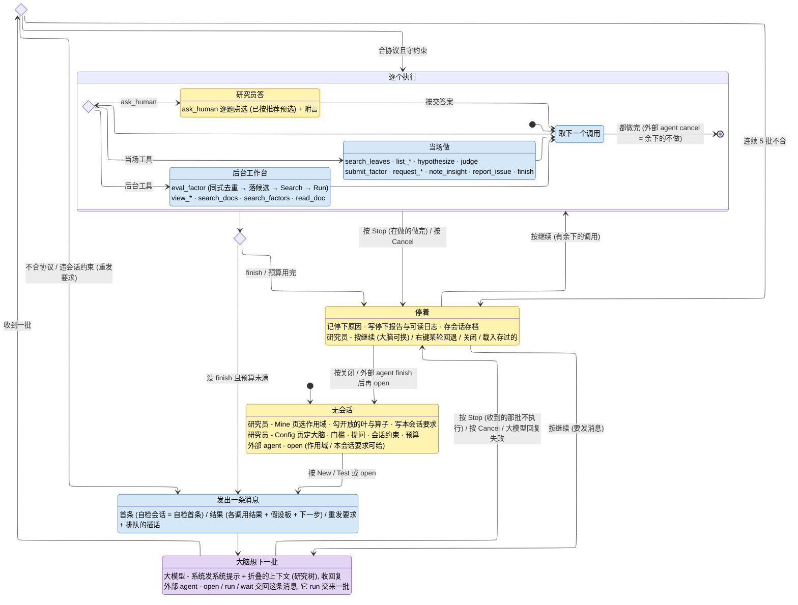

# Agent 挖因子 (外部 agent 说明书)

这是一套 A 股量化因子挖掘系统. 你是外部 agent, 当一段挖掘会话的大脑: 经 MCP 调系统的研究工具, 访问特征库、看数据、提机制假设、回测因子、把好因子提交进正式库. 系统是一个一直开着的 GUI 程序 (`python run.py`); 会话与 GUI 内置大模型挖的是**同一套**: 同一个状态机、同样的消息与会话约束、同一份日志与存档, 研究员在 GUI 的 Agent → Mine 页实时看得到每一轮, 能答你的提问、插话、停下、回退、换大脑接着做.

本文只写怎么接上和会话怎么走; 角色与做法、评估口径、判优、研究循环、回复协议、研究工具 (参数逐个)、开放的特征叶与算子全在系统提示里 (`doc`), 以它为准.

## 接入

程序一开即在本机起 MCP 服务 (Streamable HTTP, 只收 POST 的 JSON-RPC, 不开 SSE 流), 地址写在 `output/run/agent/remote.json` (`http://127.0.0.1:47821/mcp`). 两种接法:

- **MCP 客户端**: 把这个地址配成一个 HTTP MCP 服务器 (例: `devin mcp add stk http://127.0.0.1:47821/mcp`), `tools/list` 即列出全部工具 (接口工具 + 各研究工具, 参数带 JSON Schema)
- **shell**: `python py/agent.py <工具> [参数]` (最小的 MCP 客户端), 打印结果原文; `python py/agent.py list` 列全部工具
  - 参数 = JSON 对象 (缺省 `{}`) / `@文件` (读该文件的 JSON) / `-` (读标准输入; 长 JSON 用 heredoc 最省事, 不用转义)
  - 退出码 0 = 做成, 1 = 工具报错 (原文写原因)
  - 结果可能很长 (`doc` 约 7 万字): 重定向进文件再按需读, 省上下文

```bash
python py/agent.py open '{"remark": "用户交代的要求原话"}' > /tmp/first.md
python py/agent.py doc > /tmp/doc.md
python py/agent.py run - <<'EOF'
{"calls": [{"tool": "list_tried", "args": {}}, {"tool": "view_feature", "args": {"exprs": ["bar.30m.amount_30min"]}}]}
EOF
python py/agent.py wait '{"job": 2}'
```

## 会话怎么走

1. **open**: 用户在你的界面里交代的要求, 原话写进 `remark` (进系统的日志与首条消息, 研究员看得到); 作用域可给 `pool` / `level` / `hold` / `years` / `lob` (缺省 = 研究员在 GUI 选的), `test` = 自检会话. 交回**首条消息**
   - 研究员已在 GUI 开好一段等外部 agent 的会话 (他写好了本会话要求) → `open` 即接上它, 交回在等的那条消息; 进行到中途的用 `recap` 看此前的结论
   - 研究员在 GUI 里用大模型挖着 / 有停着的会话 → 退回原因, 稍后再试
2. **doc**: 读系统提示. 文中说的 "一条回复" / "本条" = 你交的一批
3. **循环**: 照首条与每条消息末尾的 "下一步" 交一批调用 (`run`, 或直接调某个研究工具 = 只有它一个调用的批) → 交回的就是**下一条消息** (各调用结果 + 假设板 + 下一步; 研究员插话时附在末尾, 与做法冲突处以它为准)
4. **挖完**: 按判优 `submit_factor` 最好的版本, 再 `finish` (须是批里最后一个调用); 会话停下, 你下次 `open` 开新会话

## 接口工具

| 工具       | 输入                                                                            | 做什么                                                                                                              |
| ---------- | ------------------------------------------------------------------------------- | ------------------------------------------------------------------------------------------------------------------- |
| `open`     | 可选 `pool` / `level` / `hold` / `years` / `lob` / `remark` / `test`            | 开会话 (或接上研究员开好的), 交回首条消息 (或在等的那条)                                                           |
| `doc`      | 无                                                                              | 本会话的系统提示                                                                                                    |
| `recap`    | 无                                                                              | 研究树: 此前各轮的假设与判定、变体结局、观察关键数、记录 (内置会话每条消息附的同一份); 上下文丢了时看              |
| `run`      | `calls`: 1..12 个 `{"tool": 研究工具, "args": {...}}`                           | 交一批; 25 秒内下一条消息发出即交回它, 否则交回进度                                                                 |
| 研究工具名 | 该工具的参数                                                                    | 只有它一个调用的批, 同 `run`                                                                                        |
| `wait`     | `job`, 可选 `seconds` (≤ 50)                                                    | 续等第 `job` 批: 下一条消息发出即交回; 会话停下 / 被关 / 被回退即交回原因; 超时交回进度                             |
| `cancel`   | `job`                                                                           | 作废在跑的批余下的调用 (在跑的作废, 落了文件的回测删掉候选; 没开的不做), 交回下一条消息                             |

- 批号 = 交批的那一轮 (首条消息是第 1 轮); 调用编号 `R<批>#<序>` 写在每个结果的标题里, `judge` 的证据引用它. 一次只跑一批: 上一批没做完不能交下一批
- 协议层不合 (未知工具 / 参数, 缺必填, 类型 / 范围 / 可选值不对, eval_factor 超 3 个, finish 不在末尾) 或开着会话约束时不守约束 → 整批退回、一个都不执行, 交回**重发要求** (isError, 不合处一次列全); 连续 5 批不合会话停下等研究员. 依赖数据的 (因子 / 特征 / 代码 / 日期 / 假设 / 证据) 不成只在该调用的结果里写原因, 其余照做
- 每个结果至多 6000 字, 超了截断并说明; 结果只交一次, 要用的数自己记下 (忘了用 `recap`)

## 研究员能做的

- **规则** (Config 页, 开会话时定, 系统提示里写着): 入库门槛、可否 `ask_human` (一次; 作业停在它上等他在 Mine 页答, 期间 `wait` 交回进度)、会话约束、预算 (轮数 / 分钟 / token; 到了会话停下)
- **插话**: 随下一条消息附上
- **停下 / 取消**: Stop = 你交的下一批收下但不执行; Cancel = 在跑的调用作废. 停着时 `run` 退回原因; 研究员按继续后, `wait` 你最后一批即交回下一条消息
- **回退**: 回到某轮发出前重来; 那之后的批作废, `wait` 交回原因, 研究员继续后 `open` 接上
- **换大脑**: 停着的会话可由内置大模型接着做, 也可交给外部 agent (`open` 接上)

## 附: 会话的状态机

大脑 = 大模型 (系统发消息、收回复) 或外部 agent (你经 MCP 取消息、交批), 其余完全同一套.

- 颜色 = 这一步谁在干活: 黄 = 等人, 紫 = 大脑, 蓝 = 系统; 菱形 = 系统判断
- 箭头: `按 X` = 研究员的操作, 其余 = 条件


