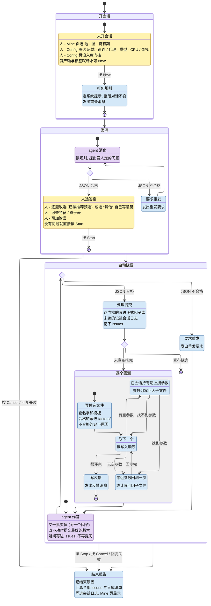

# Agent 挖因子

人在 GUI 的 Agent → Mine 页操作. 系统 (本程序) 把项目规则打包发给 agent (大模型); agent 消化后提一次问题 (每题带推荐) 由人选答; 此后全自动: agent 定下一个因子, 每轮交它的一批实验变体, 系统回测并反馈, agent 据此一处一处改, 做到改不动时把最好的版本提交入库并宣布挖完. 一段会话只做一个因子, 好坏只看分层清晰 (mono) 与多空收益: mono 不衰减的前提下每期毛多空越大越好; rIC 只作入库底线, 不看 t 值, 不管风格与相关性. 途中 agent 的疑问攒到最后一起交给人.

## 名词

| 名词       | 含义                                                                                                                  |
| ---------- | --------------------------------------------------------------------------------------------------------------------- |
| 池         | 股票池: `all` (全市场) 或某个子池                                                                                     |
| 层         | 因子在哪个频率上算: `min` / `5min` / `15min` / `30min` / `60min` / `day`                                              |
| 持有期     | 因子预测多远的收益: `30m` / `60m` / `close` / `T+1O` / `T+1C` (该层能用的才列出)                                      |
| 模板       | 因子表达式, 窗长等参数可以不写数字 (裸写 `d` / `k`), 交给 Search 定值. 例: `CsRank(TsMeanRoll(TsLog(bar.5m.amt), d))` |
| 候选       | agent 交的一个因子变体: 英文名 + 中文名 + 模板 + 一句话 (相对哪个版本改了什么、想验证什么)                            |
| 批         | agent 一次回复里的全部新候选 (1..8 个, 都是会话所做那个因子的变体)                                                    |
| Search     | 给模板里没写数字的参数找最好的取值; 可能一组都找不到 (= 无显著), 也可能找到几组                                       |
| Run        | 对一组定好值的参数做全区间分层回测, 出 score / 多空收益 / rIC / 单调性等统计                                          |
| 入库门槛   | Config 页设的统计下限 (mono / rIC 均值; 多空不设门槛); agent 提交的候选至少有一组参数全部达到才入库                   |
| 会话       | 按 New 开始的一段连续对话. 池 / 层 / 持有期 / 后端 / 模型 / 入库门槛在会话内不变                                      |
| 会话目录   | `output/agent/<池>/<层>/<持有期>/`: `factors/` 放候选因子文件 (历次会话累积), `chat/<时间>/` 放会话日志               |
| 会话日志   | 这段对话发收的每条消息 + 带毫秒时间的交互流水 `events.jsonl` (每一步一行) + 结束报告                                  |
| 提问面板   | Mine 页左栏 "问题" 页: agent 的问题逐题列出选项, 推荐项标出并预选, 每题末项 "其他" 可自己写意见; 底下一个附言框       |
| 参考表     | Mine 页左栏 "特征" / "算子" 页: 本会话发给 agent 的同一份特征表与算子表 (可过滤), 人读题、看模板用                    |
| 结果表     | Mine 页右侧: 会话目录里全部候选及其回测统计, 按 score 降序; 入库的标出                                                |
| 正式因子库 | `output/factors/<池>/<层>/`: Factors 页用的因子                                                                       |

## 状态图

- 颜色 = 这一步谁在干活: 黄 = 等人, 紫 = agent, 蓝 = 系统; 菱形 = 系统判断
- 箭头: `按 X` = 人的操作, 其余 = 条件 (成对出现)
- 状态: `人 -` = 人在这里能做的, `发出` = 系统发给 agent 的消息, 其余 = 这一步做什么



- 按 Stop: 当前这步做完再结束; 按 Cancel: 立即结束, 在跑的回复 / 回测作废
- 网络抖动一直重试 (每 30 秒一次, 不限次数), 不算失败; 按 Cancel / 退出程序随即收手
- 回复失败: 请求发出后断网 (Cursor 建 agent / 续对话的 POST 不重发) / 接口报错 (如模型在出口地区不可用) / 代理拒绝 / 回复被截断 / 平台拒答; 原因进结束报告

## 系统发给 agent 的消息

模板都在 `config/agent/prompt/` 下, Config 页可直接改.

| 消息     | 内容                                                                                                                                                                                                                             |
| -------- | -------------------------------------------------------------------------------------------------------------------------------------------------------------------------------------------------------------------------------- |
| 系统提示 | 池 / 层 / 持有期; 表达式写法; 回测口径 (每行开仓 / 分组 / 超额 / 可成交 / 复权); 入库门槛; 做法 (一个因子、每变体改一处、何为更好、何时收手); 两阶段回复格式; 该层能用的全部特征; 全部算子; 正式因子库里已有因子在该持有期的成绩 |
| 首条     | 会话目录里以前试过的候选 (历次会话累积, 可作起点接着做) + "消化规则, 提出拿不准的问题"                                                                                                                                           |
| 答复     | 每题人选的答案 (含 "其他" 自写的意见; 没照推荐的附上推荐) + 附言 + "开始挖掘; 此后不得提问, 疑问写进 issues"                                                                                                                     |
| 反馈     | 上次提交的每个候选入库与否 (未达的列出差在哪项) + 本批每个候选的结局 (下表) + "对照最好版本判断每处改动"                                                                                                                         |
| 重发要求 | 哪里不合格式 + "按格式重发"                                                                                                                                                                                                      |

## agent 的回复

每次只回一个 JSON.

澄清 (只一次):

```json
{"questions": [{"prompt": "问题", "options": ["选项", ...], "multiple": false, "recommended": [0]}, ...]}
```

- 拿不准的都可以问 (口径疑问、从哪个因子起步、取舍); 已定的 (只看分层与多空收益、不看 t 值、一段会话一个因子) 不问
- `recommended`: 推荐的选项下标; 单选恰 1 个, 多选至少 1 个
- 每题人还能选 "其他" 自己写 (单选取代选项, 多选并列), 故选项不必穷举, agent 不列兜底项

自动挖掘 (每轮):

```json
{
  "factors": [{"name": "英文名", "name_cn": "中文名", "expr": "模板", "note": "相对哪个版本改了什么、想验证什么"}, ...],
  "submit": ["已评候选的英文名", ...],
  "issues": ["疑问 / 建议", ...],
  "done": false
}
```

- `factors`: 每批 1..8 个, 都是同一个因子的变体; `done` 为 true 时为空
- `submit`: 会话目录里已评过的候选 (含以前会话的), 一般只在最后交最好的版本; 可空
- `issues`: 想问人的、对规则或系统的疑惑, 不阻塞挖掘; 可空
- `done`: true = 挖完, 本次 `submit` 处理完即结束

候选的结局 (反馈消息逐个写, 结果表 "结局" 列同样显示):

| 结局     | 含义                                                                 |
| -------- | -------------------------------------------------------------------- |
| 未落文件 | 名字或模板不合法, 或与已有的重名; 原因原样告诉 agent, 改正后可以重交 |
| BROKEN   | 文件写成了, 但回测时算不出来                                         |
| 无显著   | Search 找不到显著的参数                                              |
| 有参数组 | 每组参数给 mono / 每期多空收益 / rIC; 另附 score / 池内有效率        |
| 未评估   | 会话中途结束时还没轮到                                               |

## 交互流水

会话日志里的 `events.jsonl`, 一行一个事件: `time` (毫秒) + `event` + 下表字段 (值都是字符串).

| event        | 何时                   | 字段                                                                                                          |
| ------------ | ---------------------- | ------------------------------------------------------------------------------------------------------------- |
| `open`       | 按 New                 | pool / level / hold / backend / model / net (`direct` / `proxy 主机:端口`) / eval / gate / tried (已试候选数) |
| `ask`        | 发出一条消息           | round / kind (first / answer / round / retry) / chars                                                         |
| `reply`      | 收齐一条回复           | round / finish / error / seconds / prompt_tokens / cached_tokens / completion_tokens / chars / thinking_chars |
| `parse_fail` | 回复不合格式           | round / phase (digest / mine) / error                                                                         |
| `questions`  | 澄清回复合格           | round / n                                                                                                     |
| `pick`       | 按 Start, 每题一行     | question / picked (含 "其他: 意见") / recommended                                                             |
| `start`      | 按 Start               | note                                                                                                          |
| `mine_reply` | 挖掘回复合格           | round / factors / submit / issues / done                                                                      |
| `issue`      | 每条 issue             | round / text                                                                                                  |
| `submit`     | 每个提交               | round / name / result (入库 / 未入库原因)                                                                     |
| `stage`      | 每个新候选             | round / name / expr / note / result (落文件 / 未落原因)                                                       |
| `eval_begin` | 开始回测本批           | round / files                                                                                                 |
| `eval`       | 本批评完, 每个文件一行 | name / result (权重数与最佳统计 / 无显著 / BROKEN)                                                            |
| `eval_end`   | 本批评完               | —                                                                                                             |
| `stop`       | 按 Stop                | —                                                                                                             |
| `cancel`     | 按 Cancel              | —                                                                                                             |
| `finish`     | 进结束报告             | reason / rounds / adopted / issues                                                                            |
